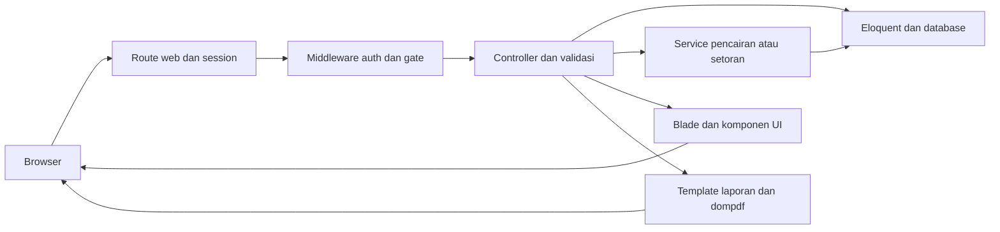

# Arsitektur dan peta kode

## Bentuk aplikasi

Gapoktan merupakan aplikasi Laravel dengan halaman yang dirender server menggunakan Blade. Form mengirim request HTTP biasa, controller memvalidasi input dan memakai Eloquent, lalu mengembalikan halaman atau redirect dengan pesan session. Alpine.js menangani interaksi kecil dan pratinjau hitungan; perhitungan yang disimpan ditentukan server.

Tidak ada route API aplikasi, SPA, atau layanan eksternal pembayaran. Kondisi rendering JSON untuk `api/*` dalam bootstrap belum berarti terdapat API. Identitas Gapoktan masih ditulis langsung di beberapa template.

## Struktur direktori

| Lokasi | Tanggung jawab |
| --- | --- |
| [`app/Http/Controllers`](../app/Http/Controllers) | Modul bisnis, validasi form, filter daftar, response |
| [`LoginRequest.php`](../app/Http/Requests/Auth/LoginRequest.php) | Validasi username, login session, pembatasan percobaan |
| [`app/Models`](../app/Models) | Relasi, cast, akses role, saldo dan perhitungan pinjaman |
| [`app/Services`](../app/Services) | Sinkronisasi pencairan dan alokasi setoran |
| [`AppServiceProvider.php`](../app/Providers/AppServiceProvider.php) | Empat gate dan pagination bawaan |
| [`helpers.php`](../app/Support/helpers.php) | Format rupiah, rupiah bertanda, dan tanggal |
| [`routes`](../routes) | Route web/auth; command `inspire` |
| [`bootstrap`](../bootstrap) | Bootstrap Laravel, routing, health endpoint `/up` |
| [`config`](../config) | Database, session, cache, queue, logging, mail, filesystem |
| [`database`](../database) | Migrasi, seeder demo, dan factory pengguna |
| [`resources/views`](../resources/views) | Halaman modul, komponen, faktur, laporan HTML/PDF |
| [`app.css`](../resources/css/app.css) | Tailwind dan kelas komponen bersama |
| [`app.js`](../resources/js/app.js) | Alpine, toast SweetAlert, konfirmasi aksi/hapus |
| [`public/img`](../public/img) | Logo, favicon, dan gambar login |
| [`tests`](../tests) | Tes bawaan yang perlu disesuaikan dengan domain |

`public/index.php` adalah entrypoint web, `artisan` adalah entrypoint CLI. Document root server mengarah ke `public/`.

## Modul dan controller

| Controller | Peran |
| --- | --- |
| `BerandaController` | Saldo kas, talangan, dan pokok beredar |
| `PenggunaController` | CRUD akun dan perlindungan administrator terakhir |
| `ProfilController` | Lihat/sunting akun sendiri |
| `KelompokTaniController` | Identitas kelompok, daftar dan tab transaksi |
| `KasController` | CRUD kas manual, saldo, faktur, proteksi baris pencairan |
| `KategoriKasController` | Tambah kategori melalui controller invokable |
| `PinjamanController` | Akad dan sinkronisasi pencairan |
| `PembayaranPinjamanController` | Pemilihan kelompok, setoran, faktur gabungan |
| `DanaTalanganController` | CRUD talangan manual dan proteksi kontribusi otomatis |
| `PengaturanController` | Persentase bunga dan potongan |
| `LaporanController` | Validasi periode, empat laporan, unduh PDF |
| `LogAktivitasController` | Filter dan daftar jejak aktivitas |
| Controller di `Auth/` | Login/logout dan endpoint perubahan sandi |

Validasi selain login berada di controller. Atribut model tidak menggantikan validasi request.

## Service keuangan

[`PencairanPinjaman`](../app/Services/PencairanPinjaman.php) menerima pinjaman dan pencatat. `sinkronkan()` membuat/memperbarui kas keluar untuk dana diterima dan kontribusi talangan, serta talangan masuk. Ia menggunakan snapshot persentase pinjaman. Service ini tidak membuka transaksi database sendiri; `PinjamanController::store()` dan `update()` membungkusnya dalam `DB::transaction()`.

[`SetoranPinjaman`](../app/Services/SetoranPinjaman.php) menerima kelompok. `tagihan()` mengambil pinjaman belum lunas yang sudah dicairkan pada tanggal setoran, urut tanggal pencairan lalu ID. Setoran tidak dikunci empat bulan. `catat()` membagi setoran, menyimpan pembayaran, mengubah tunggakan/termin/status, dan mencatat satu kas masuk dalam satu transaksi database.

`PembayaranPinjamanController::store()` memeriksa nominal maksimum sebelum memanggil service. Panggilan dari Tinker/seeder tidak melewati validasi controller. Kedua service memakai user pencatat yang diberikan, bukan menyimpulkannya dari session.

## Autentikasi dan otorisasi

Login memakai guard `web` dengan session. Kegagalan login dihitung berdasarkan username yang dinormalisasi dan IP; limit lima percobaan memakai `RateLimiter`. Login sukses meregenerasi ID session; logout menghapus session dan meregenerasi token CSRF.

Gate didefinisikan di provider dengan delegasi ke metode `User`. Route menegakkan gate dan Blade memakai `@can` untuk tombol/menu. Route tulis diletakkan sebelum route `{id}` agar `create` tidak tertangkap sebagai ID. Matriks ada di [rute dan akses](rute-dan-akses.md).

## UI dan komponen bersama

| Komponen | Penggunaan |
| --- | --- |
| `app-layout` | Sidebar, topbar, area utama, data flash session |
| `page-header` | Judul, deskripsi, kembali, slot aksi |
| `stat-card` | Ringkasan angka dan warna ikon |
| `icon` | SVG inline berdasarkan nama ikon |
| `status-badge` | Label status pinjaman/kelompok |
| `empty-state` | Baris tabel kosong |
| `input-error` | Pesan validasi |
| `input-nominal` | Masukan Kas/Pinjaman berformat Indonesia dan payload angka dua desimal |
| `tabel-kaki` | Pagination dan pilihan 10, 25, atau 50 baris |
| `tombol-hapus` | Form DELETE dengan CSRF dan konfirmasi SweetAlert |
| `faktur-layout` | Faktur HTML dengan `window.print()` |

Provider memilih `vendor.pagination.gapoktan` sebagai view pagination. Partial `_form` dipakai ulang oleh halaman create/edit.

Warna merek ada di `tailwind.config.js`, dengan warna utama `#006C49`. Pipeline CSS aktif menggunakan Tailwind 3 melalui PostCSS; dependency `@tailwindcss/vite` versi 4 tidak dipakai dalam konfigurasi Vite. Layout memaksa `color-scheme: light`, termasuk latar awal inline untuk menghindari kedip gelap. Font Inter dimuat dari Bunny Fonts dengan fallback sans lokal.

Flash `sukses`/`gagal` disalin ke atribut body lalu ditampilkan sebagai toast. Pratinjau Alpine membantu input, tetapi server menghitung ulang angka final.

[`resources/js/nominal.js`](../resources/js/nominal.js) menyediakan format/parse nominal, state Alpine masukan, dan saran jatuh tempo. Masukan yang terlihat memakai titik ribuan/koma desimal; hidden input mengirim angka kanonis dua desimal. Nilai potongan dan jumlah diterima tetap dihitung dari nominal kanonis.

## Faktur, laporan, dan format

Faktur menggunakan CSS aplikasi dan dialog cetak browser. Unduhan laporan memakai dompdf, `laporan/pdf.blade.php`, CSS dasar/tabel, logo melalui `public_path()`, A4 lanskap untuk laporan tabel, dan A4 potret untuk akhir tahun. PDF tidak membutuhkan Vite untuk tata letaknya.

Helper rupiah menampilkan nol digit desimal walaupun database menyimpan dua desimal. `tanggal_id()` memakai locale aplikasi melalui Carbon. Makna angka dijelaskan di [aturan bisnis](aturan-bisnis.md).

## Titik perubahan

Perubahan persentase menyentuh pengaturan, form, snapshot pinjaman, dan laporan. Perubahan termin/status menyentuh `Pinjaman`, `KelompokTani`, `SetoranPinjaman`, pemilihan kelompok pembayaran, serta skenario uji. Perubahan pencatatan uang perlu memeriksa kas, talangan, pembayaran, faktur, dan laporan bersama.

Belum terdapat observer audit global, job domain, atau jadwal penyegaran status. Aktivitas dicatat eksplisit oleh controller. Lihat [catatan implementasi](catatan-implementasi.md).

[Indeks dokumentasi](README.md).
