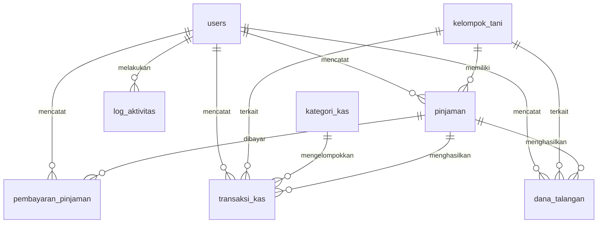

# Database dan relasi

Sumber skema adalah [`database/migrations`](../database/migrations). Nama tabel domain menggunakan bahasa Indonesia dan ditentukan eksplisit pada model. Tabel domain memiliki `id`, `created_at`, dan `updated_at`.

## Relasi domain

Diagram menunjukkan arah hubungan. Sebagian foreign key nullable seperti dijelaskan berikut. Tidak ada foreign key antara `users` dan `kelompok_tani`, ataupun hubungan langsung dari baris kas setoran ke `pembayaran_pinjaman`.

## Tabel utama

| Tabel | Kolom penting dan kegunaan |
| --- | --- |
| `users` | `name`, `username` unik, `email` unik dan nullable, `email_verified_at`, `no_hp`, `alamat`, `role`, `password`, `remember_token` |
| `kelompok_tani` | `kode` unik, `nama_kelompok`, `nama_ketua`, `nik_ketua` string 16, `no_hp`, `alamat`, `aktif` boolean default true |
| `kategori_kas` | `nama` unik, `bawaan`, `sistem`; dua flag boolean default false |
| `transaksi_kas` | `kode` unik, `tanggal`, `jenis`, `kategori_kas_id`, `kelompok_tani_id`, `pinjaman_id`, `jumlah`, `biaya`, `deskripsi`, `user_id` |
| `pinjaman` | `kode` unik, `kelompok_tani_id`, `tanggal_transaksi`, `tanggal_jatuh_tempo`, `termin`, `jumlah_pinjaman`, `potongan_persen`, `potongan_talangan_persen`, `potongan_nominal`, `jumlah_diterima`, `bunga_persen`, `tunggakan_bunga`, `status`, `deskripsi`, `user_id` |
| `pembayaran_pinjaman` | `kode` unik, `kode_setoran` nullable dan berindeks, `pinjaman_id`, `tanggal`, `bulan_bunga`, `bunga_nominal`, `bayar_pokok`, `total_bayar`, `deskripsi`, `user_id` |
| `dana_talangan` | `kode` unik, `kelompok_tani_id`, `pinjaman_id`, `tanggal`, `jenis`, `penerima` nullable, `jumlah`, `deskripsi`, `user_id` |
| `pengaturan` | `suku_bunga_pinjaman`, `potongan_operasional`, `potongan_dana_talangan`; digunakan sebagai satu baris pengaturan |
| `log_aktivitas` | `user_id`, `id_invoice` nullable, `jenis_tindakan`, `deskripsi`; waktu aktivitas memakai `created_at` |

Nominal uang disimpan sebagai `decimal(18,2)`. Persentase memakai `decimal(5,2)`. Tanggal transaksi memakai tipe `date`; waktu pencatatan memakai timestamp. `termin` adalah unsigned tiny integer, `bulan_bunga` unsigned small integer. Cast nominal Eloquent `decimal:2` menghasilkan representasi desimal; perhitungan aplikasi mengubahnya menjadi float dan melakukan pembulatan dua desimal.

## Nilai yang diperbolehkan

| Kolom | Nilai |
| --- | --- |
| `users.role` | Aplikasi menerima `sekretaris`, `bendahara`, `ketua`, `user`; kolom database berupa string dengan default `user` |
| Kas/talangan `jenis` | Enum `masuk`, `keluar` |
| `pinjaman.status` | Enum `belum_bayar`, `menunggak`, `lunas` |
| `log_aktivitas.jenis_tindakan` | Enum `input`, `sunting`, `hapus` |

Kolom role tidak dibatasi enum di database. Migrasi perubahan role mengubah default, tanpa mengonversi nilai role lama menjadi role saat ini.

`Pengaturan::ambil()` menjalankan `firstOrCreate()` dengan default bunga 2%, operasional 0,5%, dan talangan 1%. Penggunaan satu baris merupakan konvensi aplikasi; skema tidak memaksakan jumlah baris tepat satu.

## Foreign key dan penghapusan

| Hubungan | Nullable | Tindakan database saat induk dihapus |
| --- | --- | --- |
| `pinjaman.kelompok_tani_id` → kelompok | Tidak | Cascade |
| `pembayaran_pinjaman.pinjaman_id` → pinjaman | Tidak | Cascade |
| `transaksi_kas.kategori_kas_id` → kategori | Tidak | Tidak menetapkan cascade; hubungan membatasi penghapusan kategori terpakai |
| `transaksi_kas.kelompok_tani_id` → kelompok | Ya | Set null |
| `transaksi_kas.pinjaman_id` → pinjaman | Ya | Set null |
| `dana_talangan.kelompok_tani_id` → kelompok | Ya | Cascade tetap berlaku dari migrasi awal |
| `dana_talangan.pinjaman_id` → pinjaman | Ya | Cascade |
| `user_id` pada tabel keuangan dan log → users | Ya | Set null |

Controller memberi proteksi tambahan: kelompok dengan riwayat pinjaman tidak dapat dihapus, dan pinjaman dengan pembayaran tidak dapat dihapus. Penghapusan pinjaman yang diizinkan secara eksplisit menghapus kas serta talangan turunannya dalam transaksi database.

Menghapus kelompok tanpa pinjaman tetap dapat menghapus riwayat dana talangannya melalui cascade, sedangkan hubungan kas menjadi null. Penghapusan langsung lewat SQL melewati proteksi controller. Tidak ada soft delete pada model domain.

## Nilai turunan

| Nilai | Sumber perhitungan |
| --- | --- |
| Saldo kas | Jumlah kas masuk dikurangi kas keluar |
| Saldo setelah transaksi kas | Seluruh baris dengan tanggal lebih awal, ditambah baris tanggal sama dengan ID hingga baris itu |
| Saldo talangan | Talangan masuk dikurangi talangan keluar |
| Sisa pokok pinjaman | Pokok awal dikurangi semua `bayar_pokok` |
| Total bunga dibayar | Jumlah `bunga_nominal` pembayaran pinjaman |
| Status kelompok | Diturunkan dari pinjaman aktif dan keberadaan pembayaran |
| `otomatis` kas/talangan | `pinjaman_id` tidak null |

Saldo berjalan, sisa pokok, dan status kelompok tidak menjadi kolom tersimpan. Sebaliknya, status tiap pinjaman, termin, jatuh tempo, serta tunggakan bunga disimpan dan diperbarui melalui metode model/service.

## Kategori kas

Kategori bawaan manual: `Saldo Awal`, `Gaji`, `Operasional`. Kategori sistem: `Pencairan Pinjaman`, `Pembayaran Pinjaman`, `Setoran Dana Talangan`.

Flag `sistem` menyembunyikan kategori dari pilihan form manual. Kategori baru dibuat melalui `POST /kategori-kas`; tidak tersedia route menyunting atau menghapus kategori. Pencarian kategori sistem dan perhitungan beban tahunan memakai nama kategori, sehingga perubahan nama tersebut perlu memeriksa service dan laporan.

## Kode transaksi

| Entitas | Format | Sumber urutan |
| --- | --- | --- |
| Kelompok | `KT-001` | ID maksimum + 1 |
| Kas | `TXN-10001` | 10000 + ID maksimum + 1 |
| Talangan | `DT-0001` | ID maksimum + 1 |
| Pinjaman | `LP-2026-001` | Jumlah baris dibuat pada tahun sekarang + 1 |
| Pembayaran | `BP-2026-001` | Jumlah pembayaran dibuat pada tahun sekarang + 1 |
| Setoran | `ST-2026-001` | Jumlah kode setoran berbeda dibuat pada tahun sekarang + 1 |

Tahun kode memakai `now()->year` dan urutan berdasarkan `created_at`, bukan tanggal transaksi yang dipilih operator. Satu kode setoran dapat dimiliki beberapa pembayaran, sehingga `kode_setoran` tidak unik. Pembuatan kode belum memakai sequence atau penguncian; lihat [catatan implementasi](catatan-implementasi.md).

## Tabel infrastruktur

- `migrations`: status migrasi Laravel.
- `sessions`: session database; `user_id` berindeks, tanpa foreign key pada migrasi awal.
- `cache` dan `cache_locks`: cache database dan lock cache.
- `jobs`, `job_batches`, `failed_jobs`: infrastruktur queue bawaan.
- `password_reset_tokens`: tabel bawaan, meskipun route reset email tidak tersedia.

## Urutan perubahan skema

Tiga migrasi awal membuat tabel Laravel. Migrasi 26 Juli 2026 menambah field akun serta tabel domain dan menjadikan email opsional. Migrasi 30 Juli 2026 mengubah default role, menambah termin/tunggakan/snapshot talangan, kode setoran, hubungan pinjaman ke kas/talangan, flag kategori sistem, serta kelompok nullable pada talangan.

Migrasi penambahan kolom tidak otomatis merekonstruksi transaksi lama: snapshot talangan default 0, hubungan pinjaman dan kode setoran baru dapat null. Instalasi lama memerlukan penilaian data tersendiri sebelum menyamakan datanya dengan pola transaksi baru.

[Indeks dokumentasi](README.md) · [Aturan bisnis](aturan-bisnis.md).
